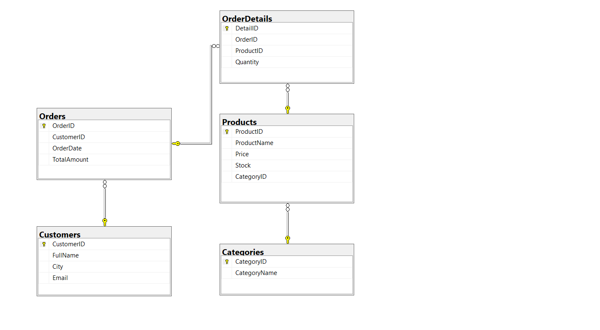

# NovaStore | E-Commerce Database Management System

A relational database management project developed using Microsoft SQL Server and T-SQL.

NovaStore simulates the database infrastructure of an e-commerce platform, focusing on relational database design, data management, SQL querying, reporting, and database backup operations.

## Technologies Used

- Microsoft SQL Server
- SQL Server Management Studio (SSMS)
- T-SQL
- Relational Database Design
- Primary Keys and Foreign Keys

## Database Architecture

The NovaStoreDB database contains five interconnected tables:

| Table | Description |
|---|---|
| Categories | Stores product categories |
| Products | Stores product details, prices and stock |
| Customers | Stores customer information |
| Orders | Stores customer orders |
| OrderDetails | Stores ordered products and quantities |

### Entity Relationship Diagram



## Sample Dataset

The database includes:

- 5 product categories
- 12 products
- 6 customers
- 10 orders
- 21 order detail records

## SQL Features

The project demonstrates:

- Database and table creation using DDL
- Data insertion using INSERT INTO
- Primary Key and Foreign Key relationships
- INNER JOIN and LEFT JOIN operations
- Data filtering using WHERE
- Aggregation using COUNT and SUM
- GROUP BY and ORDER BY
- Date calculations using GETDATE and DATEDIFF
- Database views using CREATE VIEW
- Full database backup using BACKUP DATABASE

## SQL Analysis and Reporting

Six SQL queries were developed:

1. Products with stock quantities below 20
2. Customer and order information using INNER JOIN
3. Products purchased by a specific customer
4. Product counts grouped by category
5. Total revenue generated by each customer
6. Days elapsed since each order

## Database View

The `vw_SiparisOzet` view combines customer, order and product information into a single queryable result.

```sql
SELECT * FROM vw_SiparisOzet;
```

## Getting Started

1. Install Microsoft SQL Server and SSMS.
2. Download `AhmetTas_NovaStore_Proje.sql`.
3. Open the SQL script in SSMS.
4. Connect to your SQL Server instance.
5. Execute the script on a fresh SQL Server environment.
6. Explore the database tables, relationships and queries.

Note: The script creates the database and inserts sample data. Running it again without resetting the environment can cause duplicate-object or data conflicts.

The backup section requires the `C:\Yedek` directory to exist and SQL Server to have permission to write to it.


## Project Report

The complete project report includes database design,
SQL implementations, query results, screenshots,
and backup verification.

[View the NovaStore Project Report](AhmetTas_NovaStore_Proje.docx)


## Project Context

Developed as part of the TNC Group and Software Persona professional development program.

The project demonstrates practical SQL Server database development and relational data management skills.

## Author

Ahmet Tas

Computer Engineering Graduate
